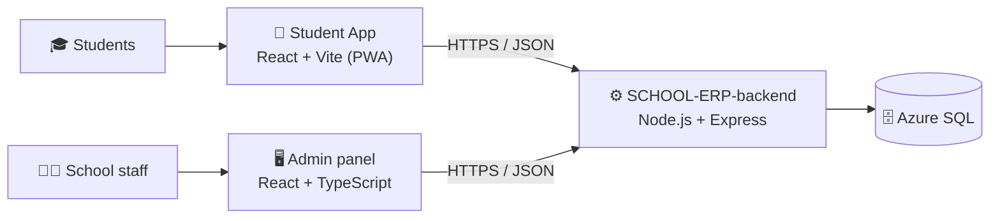
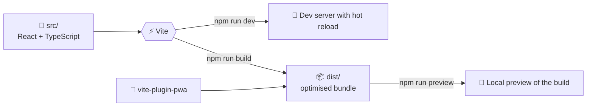

<p align="center">
  
</p>

<p align="center">
  
  
  
  
  
  
</p>

## 🎓 About

This is the **student app** of **[School Office](https://www.schooloffice.tech)**, a school management ERP for K-12 schools. It is a fast single-page app built with **React, TypeScript and Vite**, set up as a **Progressive Web App (PWA)** so it can run like a mobile app. Charts are drawn with **Recharts**, and screens are connected with **React Router**.

It is part of the School Office ecosystem, alongside the [admin panel](https://github.com/Muniramm890/schoolOfficeAdminFront) and the [backend API](https://github.com/Muniramm890/SCHOOL-ERP-backend).

## 🧱 Where it fits



## 🧰 Tech stack

| Layer | Technology | Used for |
| :-- | :-- | :-- |
| UI | React 18.3 | Component-based interface |
| Language | TypeScript 5.5 | Type-safe code |
| Build tool | Vite 6 | Fast dev server and production build |
| Routing | React Router 6 | Navigation between screens |
| Charts | Recharts 2 | Charts and visual summaries |
| PWA | `vite-plugin-pwa` | Service worker and installable app support |

## ⚙️ How it is built



## 📁 Project structure

```text
Student-app/
├── src/                  # Application source (React + TypeScript)
├── index.html            # HTML entry for Vite
├── vite.config.ts        # Vite and PWA configuration
├── tsconfig.json         # TypeScript configuration for the app
├── tsconfig.node.json    # TypeScript configuration for Vite config
├── package.json          # Scripts and dependencies
├── .gitignore
└── README.md
```

## 🚀 Getting started

**Requirements:** Node.js (18 or newer recommended) and npm.

```bash
# 1. Clone
git clone https://github.com/Muniramm890/Student-app.git
cd Student-app

# 2. Install dependencies
npm install

# 3. Start the development server (http://localhost:5173)
npm run dev
```

| Script | What it does |
| :-- | :-- |
| `npm run dev` | Starts the Vite dev server with hot reload |
| `npm run build` | Creates the production build in `dist/` |
| `npm run preview` | Serves the production build locally |

<!--
## 📸 Screenshots
Add phone screenshots to a docs/screenshots folder and show them here:

| Home | Profile |
| :-: | :-: |
|  |  |
-->

## 🔗 Related repositories

| Repository | Purpose |
| :-- | :-- |
| [SCHOOL-ERP-backend](https://github.com/Muniramm890/SCHOOL-ERP-backend) | Node.js backend and REST API |
| [schoolOfficeAdminFront](https://github.com/Muniramm890/schoolOfficeAdminFront) | React + TypeScript admin panel |
| [SchoolOffice](https://github.com/Muniramm890/SchoolOffice) | Product website |

## 📬 Contact

- 🌐 Website: [schooloffice.tech](https://www.schooloffice.tech)
- 📧 Email: [Head@schooloffice.tech](mailto:Head@schooloffice.tech)
- 👤 Developer: [Muni Ram Meena](https://github.com/Muniramm890)

<p align="center">
  
</p>
